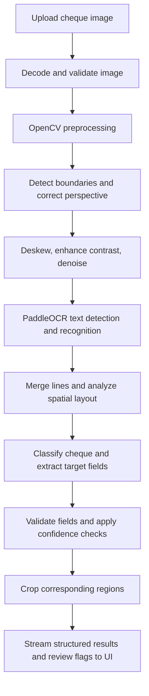

# Cheque OCR Pipeline — Computer Vision + Structured Data Extraction

**An open-source-oriented, publicly available computer vision project for turning cheque images into structured, reviewable data.**

[](https://www.python.org/)
[](https://flask.palletsprojects.com/)
[](https://opencv.org/)
[](https://github.com/PaddlePaddle/PaddleOCR)


**Repository:** https://github.com/rahildave5/cheque-vision

## Overview

Cheque OCR Pipeline is an end-to-end document-processing application that combines **computer vision (CV)**, **optical character recognition (OCR)**, and **spatial field-extraction heuristics**. Instead of simply converting an image to raw text, it processes a cheque photograph through a series of stages and returns a structured view of important banking fields.

The goal is to make semi-structured document extraction easier to inspect and review, including when uploaded photos are rotated, skewed, or unevenly lit.

## Key features

- **Computer-vision preprocessing** using OpenCV: cheque-boundary detection, perspective correction, rotation/deskewing, contrast enhancement, and denoising.
- **Text detection and recognition** using PaddleOCR, with bounding-box coordinates and confidence scores.
- **Spatial key-information extraction** to identify relevant cheque details from text positions, patterns, and neighboring regions.
- **Structured extraction** of up to five fields: bank name, branch address, account number, IFSC code, and payer name.
- **Validation and review signals**: IFSC pattern checks, missing-field detection, and an **80% confidence threshold** for flagging low-confidence results.
- **Cancelled-cheque handling** that changes which fields the pipeline attempts to return.
- **Real-time processing updates** streamed from the Flask backend with Server-Sent Events (SSE): preprocessing, OCR, and field extraction progress.
- **Field-level image crops** that help users compare extracted values with their original locations on the cheque.
- **Debug mode** for inspecting OCR detections and merged text lines.

> This is a portfolio/engineering project, **not** a bank-certified verification system. OCR output should be reviewed before any financial or operational use.

## How the pipeline works



### Processing stages

| Stage | What happens |
| --- | --- |
| **1. Preprocess (CV)** | Detects the cheque in the photograph; applies perspective correction where possible, rotation correction, CLAHE-based contrast enhancement, and denoising. |
| **2. Recognize (OCR)** | PaddleOCR detects text and returns strings, polygons/bounding boxes, and recognition scores. |
| **3. Extract & validate** | Uses cheque layout, spatial relationships, field-detection rules, and validation checks to map OCR results to structured fields; flags missing/low-confidence data and prepares field crops. |

The UI receives progress as the backend completes work; it does not display fabricated percent-complete estimates.

## Extracted fields

| Field | Meaning |
| --- | --- |
| `bank_name` | Detected bank name |
| `bank_address` | Detected branch or bank address |
| `account_no` | Detected account number |
| `ifsc_code` | Detected Indian Financial System Code |
| `payer_name` | Detected payer name (when applicable) |

Actual fields depend on the cheque image, its quality, and the pipeline's ability to identify each field.

## Tech stack

- **Language:** Python
- **Computer vision:** OpenCV, NumPy
- **OCR:** PaddleOCR
- **Backend and UI:** Flask, HTML/CSS/JavaScript templates
- **Live updates:** Server-Sent Events (SSE)
- **Extraction logic:** Spatial heuristics, text cleanup, regex/pattern validation

## Run locally

**Prerequisites:** Python 3 and `pip`. A virtual environment is recommended. PaddleOCR may require a compatible PaddlePaddle installation for your OS/CPU/GPU; consult its installation guide if the basic requirements step fails.

```bash
# 1. Clone the public repository
git clone https://github.com/rahildave5/ocr-v2.git
cd ocr-v2

# 2. Create and activate a virtual environment
python -m venv .venv

# On Windows (PowerShell)
.venv\Scripts\Activate.ps1

# On macOS/Linux, use instead:
source .venv/bin/activate

# 3. Install the project's dependencies
pip install -r requirements.txt

# 4. Start the Flask application
python app.py
```

Open **http://localhost:5000** in your browser and upload a cheque image.

**Supported formats:** JPG, JPEG, PNG, BMP, TIFF, TIF, and WebP. **Maximum upload size:** 16 MB.

### API

`POST /api/extract-stream`

- Multipart form field: `file` — cheque image.
- Response: `text/event-stream` with stage updates, field-level status events, and a final extraction result.
- Optional: `?debug=1` includes raw OCR detections and merged lines for debugging.

Example:

```bash
curl -N -X POST -F "file=@sample_cheque.png" \
  http://localhost:5000/api/extract-stream
```

Use a **synthetic or redacted sample cheque** when testing or sharing screenshots.

## Project structure

```text
ocr-v2/
├── app.py                 # Flask server, upload validation, SSE responses
├── cheque_ocr.py          # Main OCR pipeline orchestration
├── image_processing.py    # OpenCV preprocessing, OCR invocation, field crops
├── field_detection.py     # Cheque field classification and extraction rules
├── geometry_utils.py     # Bounding-box and spatial geometry utilities
├── line_merging.py       # OCR text-line grouping/merging
├── text_utils.py         # Text normalization and validation helpers
├── templates/            # Web UI templates
├── static/               # Frontend assets
├── requirements.txt      # Python dependencies
└── README.md             # Project documentation
```

## Design decisions

**Why CV before OCR?** Text recognition on photographs becomes unreliable when the document is tilted or distorted. Perspective correction, deskewing, and contrast enhancement make the source more consistent before recognition.

**Why spatial extraction instead of raw regex alone?** Cheques are semi-structured: the same value can appear in different places, and OCR often returns fragmented lines. Text position and neighboring labels help identify what each detected string represents.

**Why stream processing events?** OCR can take noticeably longer on large or difficult images. SSE gives the user useful stage-level feedback and incremental field statuses without waiting for one large response.

**Why flag uncertain results?** A readable output is not necessarily a correct output. Confidence indicators and field crops make manual validation part of the workflow.

## Limitations and roadmap

Recognition quality can vary with handwriting, glare, shadows, blur, layout differences, and image resolution. The current project uses extraction heuristics rather than a universally trained cheque-layout model. No public benchmark or accuracy percentage is claimed here.

Potential improvements include a synthetic test dataset, automated extraction tests, measurable field-level accuracy, additional cheque-layout handling, and more robust error reporting.

## Public repository, licensing, and contributions

This project is **publicly shared on GitHub** for learning, review, and collaboration. Issues and suggestions are welcome.

**Licensing note:** The repository did not have a `LICENSE` file at the time this README was prepared. Publicly visible source code is **not automatically licensed for reuse**. To formally open-source the project, add a license such as MIT or Apache-2.0 after choosing terms you are comfortable with; then replace this note with the selected license.

## Author

**Rahil Dave** · [GitHub](https://github.com/rahildave5)

